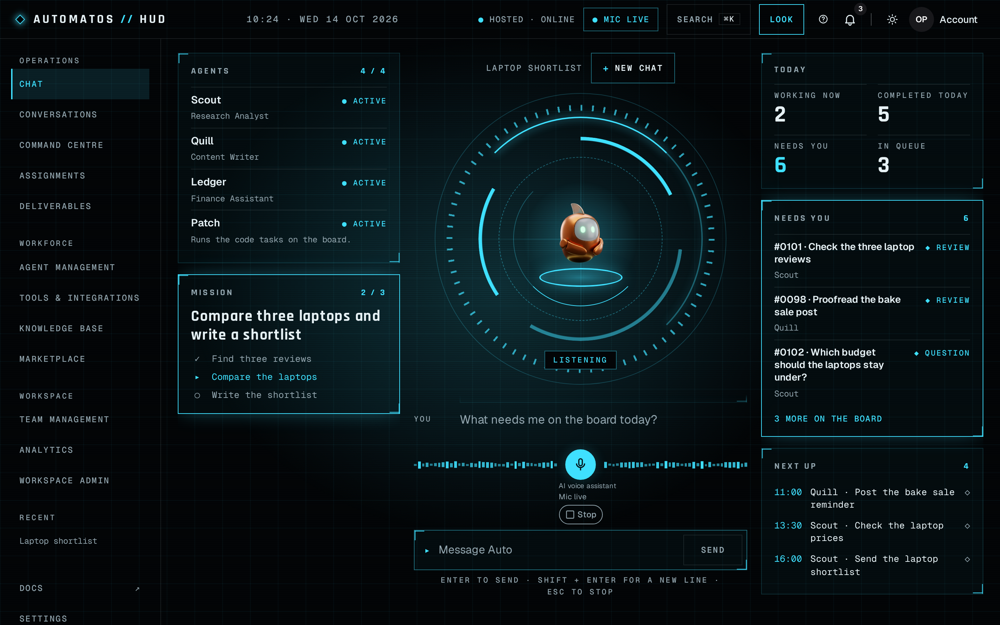
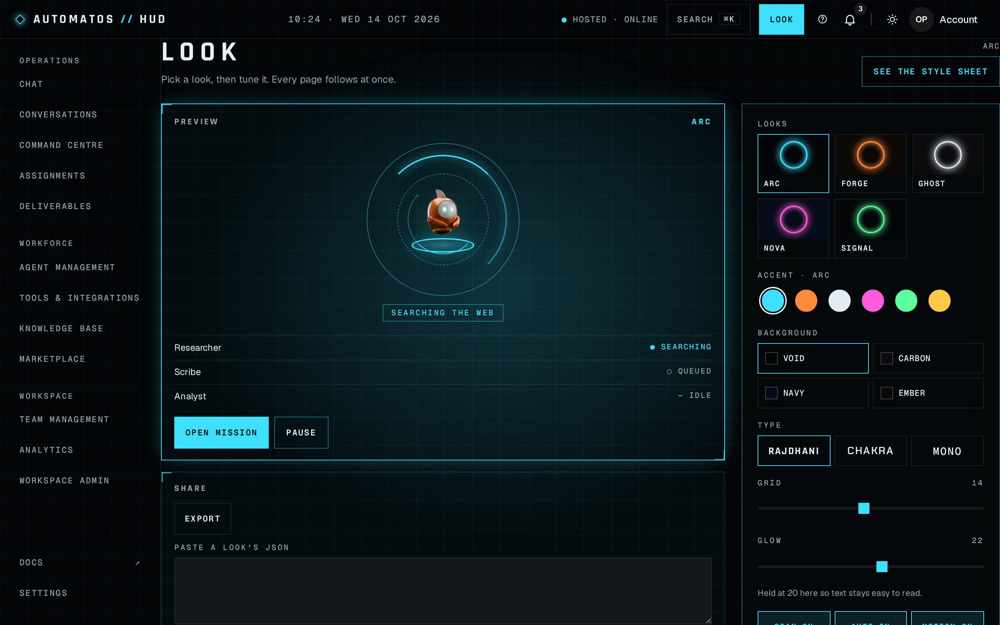
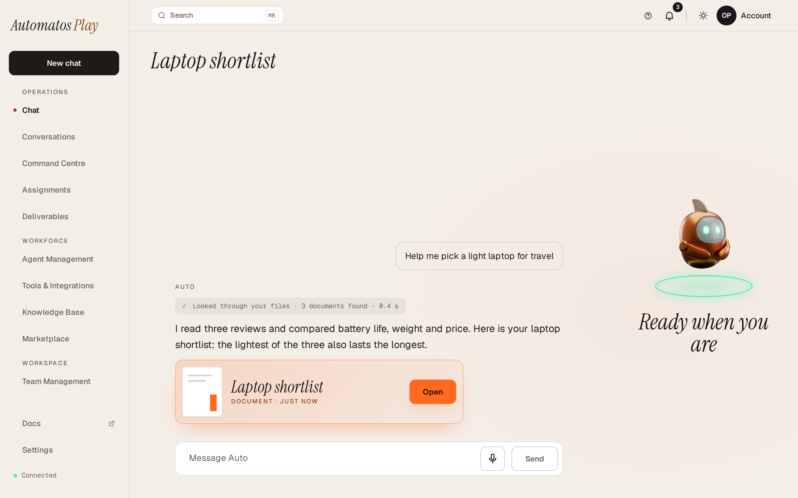
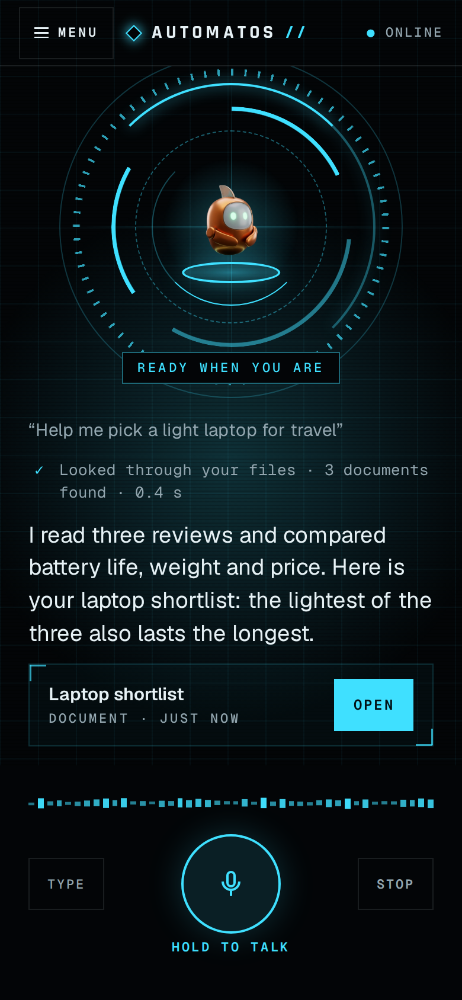

# Automatos Design Kit

Build installable themes for Automatos Studio: a frame around every page, pages of your own, looks members change,
and voice, packed into one `.autotheme` file.

<p align="center">
  
  
</p>
<p align="center"><sub>Play in its Ember look and HUD in its ARC look, drawn by the kit's browser harness on made-up data.</sub></p>

<p align="center">
  <a href="#install-a-theme">Install a theme</a> ·
  <a href="#make-your-own-theme">Make your own</a> ·
  <a href="#documentation">Documentation</a> ·
  <a href="https://github.com/AutomatosAI/automatos-design-kit/releases">Releases</a>
</p>

## Four themes ship with the kit

Play, HUD, Arcade and Candy are Automatos's own themes, and they build, check and pack with the same tools as any
theme. Each talks to Auto by voice, ships its own looks (five each for Play, HUD and Arcade, three for Candy), and
draws a phone layout in a phone's browser from 360 px wide.

<table>
  <tr>
    <td colspan="2">
      <b><a href="docs/themes/play.md">Play</a></b> 1.3.0 (<code>automatos/play</code>): warm and editorial, with Auto
      the mascot. Its own frame, chat, shelf of Deliverables and Conversations page.
      <a href="themes/play">Source</a>
    </td>
  </tr>
  <tr>
    <td></td>
    <td></td>
  </tr>
  <tr>
    <td colspan="2">
      <b><a href="docs/themes/hud.md">HUD</a></b> 1.1.3 (<code>automatos/hud</code>): a mission-control console. A
      top bar, a side rail, bracketed panels, and Auto in a voice core. <a href="themes/hud">Source</a>
    </td>
  </tr>
  <tr>
    <td></td>
    <td></td>
  </tr>
  <tr>
    <td colspan="2">
      <b><a href="docs/themes/arcade.md">Arcade</a></b> 1.0.0 (<code>automatos/arcade</code>): Automatos as a 16-bit
      role-playing game. Agents as a party, Auto as the guide in the dialogue box, Deliverables in an inventory,
      Missions as quests on a map. <a href="themes/arcade">Source</a>
    </td>
  </tr>
  <tr>
    <td colspan="2">
      <b><a href="docs/themes/candy.md">Candy</a></b> 1.0.0 (<code>automatos/candy</code>): bright, soft and glossy.
      Every card its own gradient, big round corners, today's numbers in a candy orb, and Auto in a glossy shell.
      <a href="themes/candy">Source</a>
    </td>
  </tr>
</table>

All four are released on [GitHub Releases](https://github.com/AutomatosAI/automatos-design-kit/releases), Play from
`play-v<version>` tags, HUD from `hud-v<version>` tags, Arcade from `arcade-v<version>` tags and Candy from
`candy-v<version>` tags.

## Voice in both themes

Both themes talk to Auto through the `voice` area of the Theme SDK (1.2.0). The host's voice button, `VoiceButton`,
opens the microphone on a press and draws the "AI voice assistant" caption and the stop control; the theme places and
styles it, and draws around it from `useVoice` (the session's phase) and `readVoiceLevels` (the member's and Auto's
levels, for a waveform or a mascot).

- **HUD**: hold Space or the button to talk on a desktop, with MIC LIVE in the top bar and a waveform around the
  button; on a phone, HOLD TO TALK between TYPE and STOP.
- **Play**: the button sits between the message and Send, and Auto listens, thinks and speaks with the session.

Neither theme captures or plays audio itself. A theme's `dist/` that names the browser's audio APIs is an error in
`automatos-theme check`, and the Marketplace review refuses it. A theme of your own adds voice the same way:
`^1.2.0` in `engines.sdk`, `voice` in `uses`, and `VoiceButton` where the theme wants it
([guides/sdk.md](guides/sdk.md#voice)).

## Looks

A look is a preset a member picks, changes and saves as their own. Play has five presets over six knobs (ground,
accent, font, Auto's shell and light, glow); HUD has five over eight (accent, background, type, grid, glow, scan
lines, Auto, motion). The active look paints the host's own pages inside the theme's frame too
([guides/looks.md](guides/looks.md)).

<p align="center">
  
  
</p>
<p align="center"><sub>HUD's look editor in ARC, and Play's chat in Daylight.</sub></p>

## On a phone

In a phone's browser, both themes draw a phone layout below 1024 px, down to 360 px wide: Play a bar with Menu,
Chats and Shelf; HUD a top bar with MENU and its core screen.

<p align="center">
  
  
</p>

The Automatos Go phone app runs no theme code. A theme's phone skin is data: `theme.json`'s optional `mobile` block
holds colours, font files and Auto's clips or stills, and Automatos Go paints it onto a layout built into the app
(Play and HUD have layouts of their own in the app). `automatos-theme dev` has a phone view that draws the skin as the
app does, and a skin designer that exports it ([guides/mobile-skins.md](guides/mobile-skins.md)).

## Install a theme

On a local or open-source edition of Automatos:

1. Download `automatos.play-<version>.autotheme`, `automatos.hud-<version>.autotheme`,
   `automatos.arcade-<version>.autotheme` or `automatos.candy-<version>.autotheme` from
   [Releases](https://github.com/AutomatosAI/automatos-design-kit/releases).
2. As a workspace owner or admin, open Settings › Appearance › Themes › Install theme and choose the file. When the
   release carries a `<version>.sig.json`, add it with **Add its signature file**.
3. Choose the theme there, or from the theme menu. An upload without a signature that verifies is private: each
   member opts in to its code before it runs for them.

On the hosted edition, a theme installs from Marketplace › Themes once it is listed there.
[Install Play](#install-play), [Install HUD](#install-hud), [Install Arcade](#install-arcade) and
[Install Candy](#install-candy), below, have the checksums, signatures and listing.

## Make your own theme

You need Git, Node 22.18 or later and npm 11.6 or later (`package.json` `engines`); Node runs the CLI's TypeScript
directly. Node 22 ships npm 10, which can't install the kit (it stops with an `edgesOut` error): check with
`npm --version`, and if it is older than 11.6, install with `npx -y npm@11.21.1 ci` in place of `npm ci` below, or
upgrade once with `npm install -g npm@11.21.1`. From a clone of the kit:

```sh
npm ci                                            # the kit's dependencies, exactly as package-lock.json has them
npx automatos-theme new acme/harbour              # writes themes/harbour from the minimal template; it builds and packs as it is
(cd themes/harbour && npm run build)              # the theme's own build: dist/ with the kit's preset
npx automatos-theme dev themes/harbour            # in a terminal of its own: your theme on http://127.0.0.1:4319/ (and /phone) until Ctrl-C
npx automatos-theme check design themes/harbour   # the look data: schema, presets, first-paint table, colour pairs
npx automatos-theme check themes/harbour          # the server's review checks, in the server's report shape
npx automatos-theme pack themes/harbour --out out # out/acme.harbour-0.1.0.autotheme and its .sha256.json
```

Then install `out/acme.harbour-0.1.0.autotheme` in Automatos: Settings › Appearance › Themes › Install theme, or
`npx automatos-theme install out/acme.harbour-0.1.0.autotheme --to http://localhost:8000 --choose` on a local edition.

- `new` starts from `templates/minimal` (a frame with the host's pages inside it, a look editor, a style sheet and two
  presets); `--template full` starts from Play without its brand. Both build, check and pack before you change a line.
- `dev` draws the theme in the kit's browser harness, a mock host with made-up data and nothing of Automatos running,
  and builds it again after each change under `src/`. `/phone` is the phone view.
- `install` sends the package to a local Automatos (`--to` takes the API's address, or the web app's where the web app
  serves `/automatos-host.json`), opts you in to it and, with `--choose`, makes it your theme there. No other command
  above sends anything anywhere.
- For the Marketplace, a listing shows screenshots per look: web previews from the harness
  (`npx automatos-theme shots`, then `previews --from`) and phone screenshots taken in Automatos Go (`previews --phone`),
  up to 24 of each, named `<look>` or `<look>-<screen>`
  ([guides/contract.md](guides/contract.md#screenshots-for-the-marketplace)).
- The build prints "didn't resolve at build time" once for each font a theme ships. That is expected: a font's URL
  (`../assets/fonts/…`) is resolved by the browser against `dist/theme.css` in the installed package.
- `themes/harbour` is a new npm workspace of the kit, so the next `npm ci` says `package-lock.json` is out of sync:
  run `npm install` once in your copy. (The kit's own repository writes its lockfile with the `kit-lockfile.yml`
  dispatch instead, `AGENTS.md`, "Adding a dependency".)

### From a design

A theme usually starts as a design. [guides/designing-a-theme.md](guides/designing-a-theme.md) is what the designer
needs (Claude Design or any other tool): what the host draws and the theme only places, what data a theme can show,
and the shapes of looks and knobs the kit takes, with a prompt to start a design session from.
[guides/from-design-to-theme.md](guides/from-design-to-theme.md) is the path from that design to an installed theme:
the handoff, `automatos-theme check handoff`, one prompt to Claude Code in a clone of the kit, and the checks.

For an agent, [`skills/`](skills/README.md) has the order of work (building a theme, writing its looks, its mascot, its
phone skin, passing the Marketplace review) and [`guides/`](guides/README.md) has every fact it needs: nothing outside
this repository is needed to build, check and pack a theme. Installing it needs an Automatos to install into.

## The tools

- **`automatos-theme`**, the command line: `new`, `dev`, `check`, `pack`, `install` and `submit`, with `shots`,
  `previews` (the listing's web previews and phone screenshots), `brief`, `clone` and `skin` ([docs/cli.md](docs/cli.md)).
- **The browser harness**: a mock host page that draws a theme from its folder with nothing of Automatos running.
  `dev` serves it with a phone view and a skin designer; `shots` photographs every view on Chromium and WebKit with
  Playwright and scans each shot with axe. Kit CI runs it on every pull request
  ([docs/cli-harness.md](docs/cli-harness.md)).
- **The Theme SDK 1.3.0** (`@automatos/theme-sdk`): the one module a theme imports from the host, in areas such as
  `chat`, `deliverables`, `looks`, `storage`, `voice`, `proactive` and the core pages' data ([guides/sdk.md](guides/sdk.md)). The
  kit vendors its type declarations; the same types are published at
  `https://widgets.automatos.app/theme-sdk/v1/theme-sdk.tgz`.
- **Review and signing**: `check` runs the server's review checks before you upload. A person reviews every version
  before the Marketplace lists it, and a version Automatos vouches for is signed with Automatos's theme-signing key,
  whose public key is in [`keys/theme-signing.json`](keys/theme-signing.json) ([docs/releasing.md](docs/releasing.md)).

## What a theme is

A theme ships as one `.autotheme` file, a plain zip that an Automatos server checks, stores and draws for each member
who chooses it. It has two parts:

- **The web theme: code.** A theme's `src/` is built into `dist/entry.js` and `dist/theme.css`, which the Automatos
  web app loads into its own page. Through `@automatos/theme-sdk`, the one module the host serves it, the theme fills
  the host's slots (the frame around every page, the look editor, the style sheet, the 404), replaces some core pages
  with its own, adds pages of its own under `/x/`, and ships looks: presets a member picks and changes. A person
  reviews every version before the Marketplace lists it, and a version Automatos vouches for is signed: the
  signature covers exactly its files ([docs/releasing.md](docs/releasing.md)).
- **The phone skin: data.** `theme.json`'s optional `mobile` block gives a phone app colours, font files and Auto's
  clips or stills, and nothing else. A phone app draws it onto a layout built into the app, because an app store
  allows no downloaded code: the server never gives a phone the address of a JS or CSS file. Core serves the block to
  a phone through `GET /api/themes/mobile/{install_id}`, and Automatos Go paints it onto the app's Studio layout
  ([guides/mobile-skins.md](guides/mobile-skins.md)).

A built package installs and runs the same way on the local edition and the hosted edition of Automatos: the format
carries no edition switch. The command line is narrower: its `install` and `submit` commands are exercised against
the local edition. It has no sign-in of its own, so against a hosted API `submit` sends whatever
`AUTOMATOS_API_TOKEN` holds and will usually print the server's 401 or 403. `AGENTS.md` has the kit's contract and
layout in full.

## What's in the repository

| Path | What it is |
|---|---|
| [`packages/theme-cli`](packages/theme-cli/README.md) | `automatos-theme`, the command line: `pack`, `check`, `check design`, `new`, `brief`, `clone`, `skin`, `dev`, `shots`, `previews`, `install`, `submit` ([docs/cli.md](docs/cli.md)) |
| [`packages/vite-preset`](packages/vite-preset/README.md) | `@automatos/vite-preset`: the Vite build every theme uses, with the source guard that keeps a build to the theme's own `src/` |
| [`packages/theme-harness`](packages/theme-harness/README.md) | `@automatos/theme-harness`: the vitest preset a theme's tests run on (a fake SDK and a fake host), and the browser harness `dev` and `shots` serve |
| [`packages/theme-sdk`](packages/theme-sdk/README.md) | The type declarations of `@automatos/theme-sdk` 1.3.0, vendored from core; the host serves the real module |
| [`packages/look-kit`](packages/look-kit/README.md) | `@automatos/look-kit`: a look's custom properties, Studio's tokens, the WCAG contrast math and the look validator; a theme bundles it |
| [`packages/mascot`](packages/mascot/README.md) | `@automatos/mascot`: Auto's state machine, clip player, media chooser, captions and the Pause Auto control; a theme bundles it |
| [`packages/theme-rules`](packages/theme-rules/README.md) | `@automatos/theme-rules`: the JS rules the Marketplace review runs on a package's `source/` |
| [`packages/eslint-plugin`](packages/eslint-plugin/README.md) | `@automatos/eslint-plugin`: the same rules as ESLint rules, for a theme's `lint` |
| [`themes/play`](themes/play/README.md) | Play (`automatos/play`): Automatos with Auto the mascot ([docs/themes/play.md](docs/themes/play.md)) |
| [`themes/hud`](themes/hud/README.md) | HUD (`automatos/hud`): Automatos as a command deck ([docs/themes/hud.md](docs/themes/hud.md)) |
| [`themes/arcade`](themes/arcade/README.md) | Arcade (`automatos/arcade`): Automatos as a 16-bit role-playing game ([docs/themes/arcade.md](docs/themes/arcade.md)) |
| [`themes/candy`](themes/candy/README.md) | Candy (`automatos/candy`): Automatos bright, soft and glossy ([docs/themes/candy.md](docs/themes/candy.md)) |
| [`templates/`](templates/) | What `automatos-theme new` starts a theme from: `minimal` (a frame, a look editor, a style sheet, two presets) and `full` (Play without its brand); [`templates/ralph`](templates/ralph/README.md), a template for running a theme wave with an agent loop |
| [`guides/`](guides/README.md) | The host contract, the page inventory, the SDK, looks, where the mascot goes, phone skins, and the pitfalls |
| [`skills/`](skills/README.md) | Agent skills for building a theme, writing its looks and passing the Marketplace review |
| [`references/`](references/README.md) | Two design references (Ember, which Play came from, and Command, which HUD came from), to read, never to build from |
| [`scripts/`](scripts/) | Play's look compiler (`compile-looks.mjs`), the released-themes guard (`release/`), the Marketplace review job (`review/`) and the signing scripts (`sign/`) |
| [`tests/`](tests/) | The kit's own tests: the workspaces, the pins, the workflows, the guides, the templates and the scripts |
| [`keys/theme-signing.json`](keys/theme-signing.json) | The public keys a theme signature verifies against |
| [`.github/workflows/`](.github/workflows/) | Kit CI (`kit.yml`), theme release, review and signing, and the lockfile dispatch ([docs/releasing.md](docs/releasing.md)) |
| [`docs/`](docs/) | This kit's reference: the CLI, the architecture, releasing, each theme, Play's history, its official listing and the showcase images (`docs/assets/showcase/`) |

## Documentation

The kit's reference:

- [docs/cli.md](docs/cli.md): every `automatos-theme` command, its flags, what it refuses and its exit codes;
  [docs/cli-design.md](docs/cli-design.md) has the design commands, `brief`, `clone` and `skin`, and
  [docs/cli-harness.md](docs/cli-harness.md) the browser harness's, `dev`, `shots` and `previews`, and the
  [showcase shots](docs/cli-harness.md#the-showcase-shots) this page's images come from.
- [docs/architecture.md](docs/architecture.md): how the packages fit, the source guard, the package layout, what the
  kit takes from core and at which commit, and the harness's mock host.
- [docs/releasing.md](docs/releasing.md): how a theme version is released, reviewed and signed, and how a dependency
  changes.
- [docs/themes/play.md](docs/themes/play.md), [docs/themes/hud.md](docs/themes/hud.md),
  [docs/themes/arcade.md](docs/themes/arcade.md) and [docs/themes/candy.md](docs/themes/candy.md): the four themes.
- [docs/PLAY-HISTORY.md](docs/PLAY-HISTORY.md): where Play's code came from.
- [docs/OFFICIAL-LISTING.md](docs/OFFICIAL-LISTING.md): the run that lists a theme as official.

The guides, for a theme author ([guides/README.md](guides/README.md) is their index):

- [guides/contract.md](guides/contract.md): the package, `theme.json`, the slots, pages, routes, modules, CSS and the
  `mobile` block.
- [guides/page-inventory.md](guides/page-inventory.md): the core pages a theme may replace.
- [guides/sdk.md](guides/sdk.md): every name of `@automatos/theme-sdk`.
- [guides/looks.md](guides/looks.md): the look schema, presets, the first-paint table and `check design`.
- [guides/mascot-placement.md](guides/mascot-placement.md): where a mascot can go.
- [guides/mobile-skins.md](guides/mobile-skins.md): the phone skin, `theme.json`'s `mobile` block, from the skin
  designer to a packed theme.
- [guides/pitfalls.md](guides/pitfalls.md): what went wrong building Play, and what now catches it.

## Install Play

- **A local or open-source edition:** download `automatos.play-<version>.autotheme` from [Play's releases](https://github.com/AutomatosAI/automatos-design-kit/releases) (its `.sha256` is next to it), then Settings › Appearance › Themes › Install theme. A signed version's release also carries `<version>.sig.json`: add it in the same place with **Add its signature file**, and Automatos checks it before anything is installed. A package installs without it too.
- **The hosted edition:** Play installs from the Marketplace (Marketplace › Themes) once it is listed there, with nothing to download. It shows as **Official** when the listed version carries an Automatos signature ([docs/OFFICIAL-LISTING.md](docs/OFFICIAL-LISTING.md)).

How a Play version is released, reviewed, signed and listed: [docs/OFFICIAL-LISTING.md](docs/OFFICIAL-LISTING.md).

## Install HUD

HUD is released the same way: a `hud-v<version>` tag puts `automatos.hud-<version>.autotheme` and its `.sha256` on
the same releases page, and a local or open-source edition installs it with Settings › Appearance › Themes › Install
theme. Its review, signature and listing follow Play's steps, with HUD's tag and names
([docs/OFFICIAL-LISTING.md](docs/OFFICIAL-LISTING.md)).

## Install Arcade

Arcade is released the same way: an `arcade-v<version>` tag puts `automatos.arcade-<version>.autotheme` and its
`.sha256` on the same releases page, and a local or open-source edition installs it with Settings › Appearance ›
Themes › Install theme. Its review, signature and listing follow Play's steps, with Arcade's tag and names
([docs/OFFICIAL-LISTING.md](docs/OFFICIAL-LISTING.md)).

## Install Candy

Candy is released the same way: a `candy-v<version>` tag puts `automatos.candy-<version>.autotheme` and its `.sha256`
on the same releases page, and a local or open-source edition installs it with Settings › Appearance › Themes ›
Install theme. Its review, signature and listing follow Play's steps, with Candy's tag and names
([docs/OFFICIAL-LISTING.md](docs/OFFICIAL-LISTING.md)).

## Licence

Code: Apache-2.0 (`LICENSE`). The Auto mascot's clips and stills: (c) Automatos AI, not covered by the code licence (`NOTICE`).

The mascot's clips and stills are committed in `themes/play/assets/mascot/` and, the same 36 files, in
`themes/hud/assets/mascot/`, under their own notice (`NOTICE`); the pipeline that made them (`/mascot/`) stays local.
